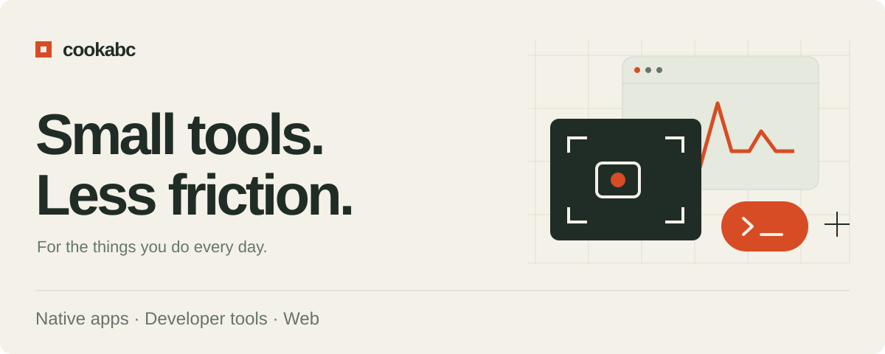
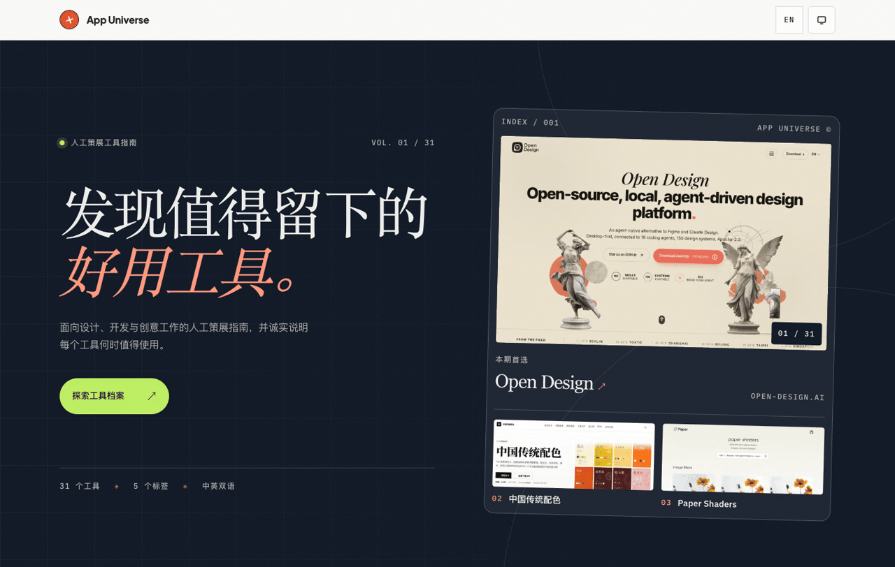

<picture>
  <source media="(max-width: 600px)" srcset="assets/redesign-20261028/cover-mobile.svg">
  <source media="(prefers-color-scheme: dark)" srcset="assets/redesign-20261028/cover-dark.svg">
  
</picture>

# Hi, I'm cookabc.

I build **native macOS utilities, developer tools, and small web experiences**.  
做小而顺手的工具，让日常少一点折腾。

[Selected work](#selected-work) · [Developer tools](#developer-tools) · [All repositories →](https://github.com/cookabc?tab=repositories)

---

## Selected work

### 01 — Kachi
**Finance English, made into a daily practice.**  
金融英语学习 PWA：本地优先、支持离线，无需账户。

<a href="https://github.com/cookabc/Kachi/blob/3897e1d8d238b1ebc7a404d324793595b4561956/docs/images/home.png">
  <picture>
    <source media="(max-width: 600px)" srcset="assets/redesign-20261028/products/kachi-mobile.png">
    
  </picture>
</a>

`React` `TypeScript` `PWA`  
**[Try Kachi →](https://kachi-game.vercel.app)** · [Source →](https://github.com/cookabc/Kachi)

[项目原图](https://github.com/cookabc/Kachi/blob/3897e1d8d238b1ebc7a404d324793595b4561956/docs/images/home.png) · 手机显示课程卡片的真实裁切

### 02 — App Universe
**A considered collection of useful tools.**  
人工精选的中英双语工具目录，面向设计、游戏与效率场景。

`Next.js` `React` `TypeScript`  
**[Explore the directory →](https://app-universe.vercel.app)** · [Source →](https://github.com/cookabc/app-universe)

[项目原图](https://github.com/cookabc/app-universe/blob/e2dc018a548d60a4b669677f58b60aee6084e1d6/docs/images/home.png)

### 03 — Vitals
**Your Mac, at a glance.**  
菜单栏里的像素风系统仪表盘，查看 CPU、内存、网络、磁盘、电池和进程。

`Swift` `SwiftUI` `macOS`  
[Explore Vitals →](https://github.com/cookabc/vitals)

[项目原图](https://github.com/cookabc/vitals/blob/2e48409967ef7c32d1b97de166f162496223bcc1/docs/images/overview.png)

### 04 — Framelet
**Capture a window. Keep the moment.**  
原生 macOS 窗口与区域录屏，支持暂停、继续与视频 / GIF 导出。

`Swift` `macOS` `ScreenCaptureKit`  
[Explore Framelet →](https://github.com/cookabc/Framelet)

[项目原图](https://github.com/cookabc/Framelet/blob/5e57859db981e04e7726005e65bcc2c362262768/docs/images/overview.png)

查看启动界面（项目原图，非录制中画面）

作品图来自各项目公开仓库；图中数字为原图状态。点击图片查看原图。

---

## Developer tools

**[zcode-inspector](https://github.com/cookabc/zcode-inspector)**  
See what coding agents leave behind. Inspect ZCode, Codex, Claude Code, and Cursor disk usage before choosing what to clean. Zero-dependency Node.js.  
看清落盘文件与清理后果，再决定下一步。

**[ai-toolbox](https://github.com/cookabc/ai-toolbox)**  
Local Codex & Claude Code usage stats and provider switching, in a native macOS menu-bar panel.  
把 AI 编码工具的本地用量和供应商切换放进菜单栏。

**Dependency updates, inside VS Code**  
Inline update hints and one-click upgrades, with major-version warnings.  
[Python dependencies →](https://github.com/cookabc/python-dependencies-updater) · [npm dependencies →](https://github.com/cookabc/npm-dependencies-updater)

---

Small tools, made useful. · [Explore all repositories](https://github.com/cookabc?tab=repositories)
