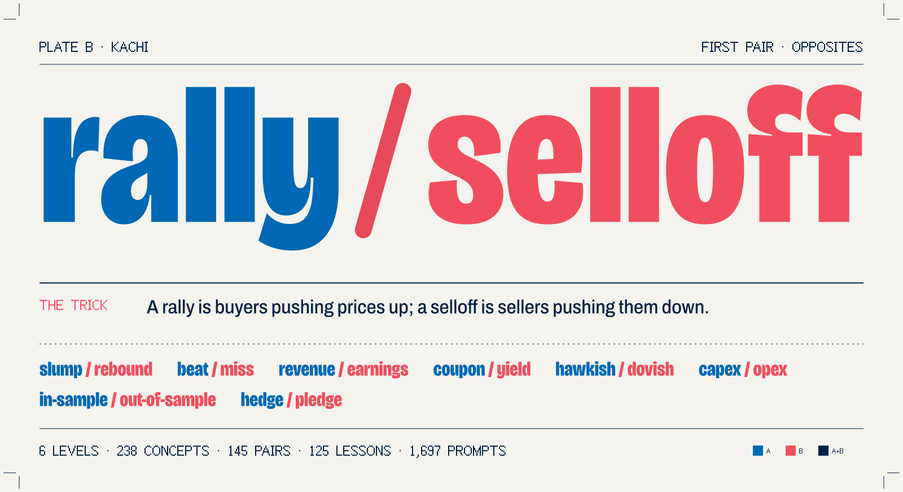
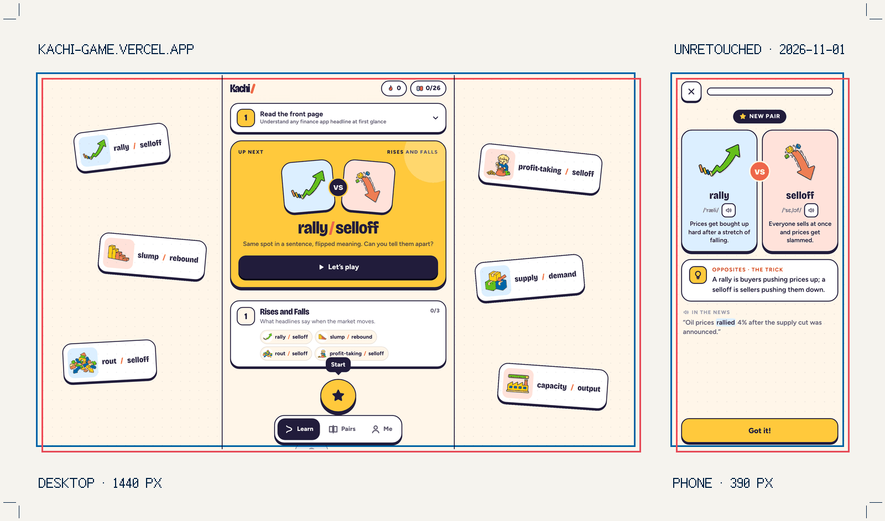
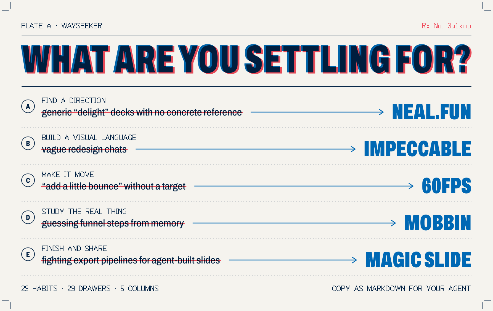
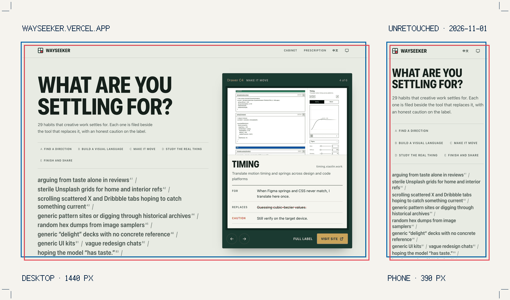

**English** · [简体中文](README.zh-CN.md)

<picture>
  <source media="(max-width: 600px) and (prefers-color-scheme: dark)" srcset="assets/proof-20261101/masthead-mobile-dark.svg">
  <source media="(max-width: 600px)" srcset="assets/proof-20261101/masthead-mobile-light.svg">
  <source media="(prefers-color-scheme: dark)" srcset="assets/proof-20261101/masthead-dark.svg">
  
</picture>

Hi, I’m **cookabc**. I make small tools that help you tell things apart: a word from its twin, a habit from the tool that replaces it.

[Kachi](#kachi) · [Wayseeker](#wayseeker)

## Kachi

**Finance English, taught in pairs.** In a headline, one wrong word flips the story — so every word arrives beside the twin it gets confused with, and every question is decided by the difference.

**[Play Kachi →](https://kachi-game.vercel.app/)** · [Source](https://github.com/cookabc/Kachi)

<a href="https://kachi-game.vercel.app/">
<picture>
  <source media="(max-width: 600px) and (prefers-color-scheme: dark)" srcset="assets/proof-20261101/kachi-proof-mobile-dark.svg">
  <source media="(max-width: 600px)" srcset="assets/proof-20261101/kachi-proof-mobile-light.svg">
  <source media="(prefers-color-scheme: dark)" srcset="assets/proof-20261101/kachi-proof-dark.svg">
  
</picture>
</a>

Twin teach cards with art, IPA and recorded audio · eight exercise types, from headlines to spot-the-flaw audits · no hearts, no failing — a miss comes back once as a rehearsal · spaced review per pair · offline PWA, no account, progress stays on your device.

<a href="https://kachi-game.vercel.app/">
<picture>
  <source media="(max-width: 600px) and (prefers-color-scheme: dark)" srcset="assets/proof-20261101/kachi-screens-mobile-dark.png">
  <source media="(max-width: 600px)" srcset="assets/proof-20261101/kachi-screens-mobile-light.png">
  <source media="(prefers-color-scheme: dark)" srcset="assets/proof-20261101/kachi-screens-dark.png">
  
</picture>
</a>

## Wayseeker

**What are you settling for?** A cabinet of 29 design and code tools, each filed beside the habit it replaces — with an honest caution on the label. Pick one drawer per stage and it writes you a five-line prescription to hand to your agent as Markdown.

**[Open the cabinet →](https://wayseeker.vercel.app/)** · [Source](https://github.com/cookabc/wayseeker)

<a href="https://wayseeker.vercel.app/?plan=3u1xmp">
<picture>
  <source media="(max-width: 600px) and (prefers-color-scheme: dark)" srcset="assets/proof-20261101/wayseeker-proof-mobile-dark.svg">
  <source media="(max-width: 600px)" srcset="assets/proof-20261101/wayseeker-proof-mobile-light.svg">
  <source media="(prefers-color-scheme: dark)" srcset="assets/proof-20261101/wayseeker-proof-dark.svg">
  
</picture>
</a>

Five columns follow the work: find a direction → build a visual language → make it move → study the real thing → finish and share. Every label says when to use the tool, what it replaces and what to watch for. Bilingual, in English and 中文.

<a href="https://wayseeker.vercel.app/">
<picture>
  <source media="(max-width: 600px) and (prefers-color-scheme: dark)" srcset="assets/proof-20261101/wayseeker-screens-mobile-dark.png">
  <source media="(max-width: 600px)" srcset="assets/proof-20261101/wayseeker-screens-mobile-light.png">
  <source media="(prefers-color-scheme: dark)" srcset="assets/proof-20261101/wayseeker-screens-dark.png">
  
</picture>
</a>

About these sheets

Each sheet is printed in two inks, like a risograph proof: blue for what to keep, red for what to strike. Every word on them comes from the live products — Kachi’s rally / selloff card, and Wayseeker’s [prescription No. 3u1xmp](https://wayseeker.vercel.app/?plan=3u1xmp). The screens are unretouched captures of the live sites, taken on 1 November 2026 at 1440 px and 390 px wide. Counts are from each repository on that date.

---

Two inks, one press. Stay curious.
