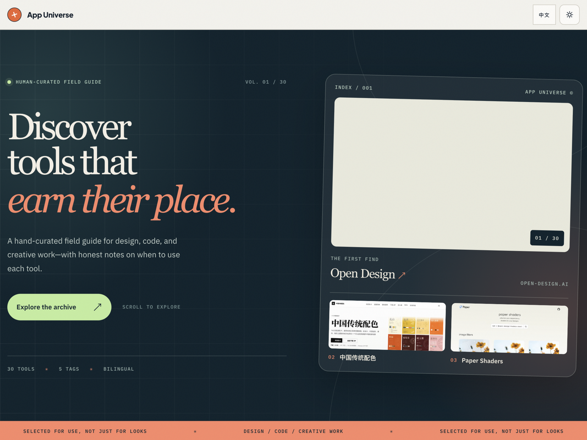

  <picture>
    <source media="(prefers-color-scheme: dark)" srcset="assets/banner-dark.svg">
    
  </picture>

  
  &nbsp;
  

  <picture>
    <source media="(prefers-color-scheme: dark)" srcset="assets/hdr-menubar-dark.svg">
    
  </picture>

<table>
  <tr>
    <td width="50%" valign="top">
        
      <b><a href="https://github.com/cookabc/vitals">Vitals</a></b> — a system monitor that lives only in the menu bar. A live CPU mini-curve sits in the bar itself; a pixel dashboard behind it covers CPU, GPU, memory, network, disk, battery and processes. Swift 6, macOS 26+.  
      
      
      
    </td>
    <td width="50%" valign="top">
        
      <b><a href="https://github.com/cookabc/ai-toolbox">AI Toolbox</a></b> — local usage, trends and provider switching for Codex &amp; Claude Code, in a pixel-styled panel. Reads this Mac's own logs; never touches a remote bill or quota. Swift 6, zero SPM dependencies, macOS 13+.  
      
      
      
    </td>
  </tr>
</table>

  <picture>
    <source media="(prefers-color-scheme: dark)" srcset="assets/hdr-browser-dark.svg">
    
  </picture>

<table>
  <tr>
    <td width="50%" valign="top">
        
      <b><a href="https://kachi-rho.vercel.app">Kachi</a></b> · <a href="https://github.com/cookabc/Kachi">repo</a> — a finance-English learning PWA: 40 word pairs told apart, 23 lessons, 208 quiz questions and a knowledge-graph view. Offline-capable, local-first, no account. React + Vite.  
      
      
    </td>
    <td width="50%" valign="top">
        
      <b><a href="https://app-universe.vercel.app">App Universe</a></b> · <a href="https://github.com/cookabc/app-universe">repo</a> — a bilingual (EN/中文) curated directory of 30 design, gaming and productivity tools, each entry with a live preview and honest notes on when to use it. Next.js.  
      
      
    </td>
  </tr>
</table>

**[zcode-inspector](https://github.com/cookabc/zcode-inspector)** — 把 `~/.zcode` 摊开看清楚：每一类东西占多少、删了会怎样，然后决定清掉哪些。扫描只读 `stat`，从不读取文件内容。

   
  
  
  

  <picture>
    <source media="(prefers-color-scheme: dark)" srcset="assets/hdr-editor-dark.svg">
    
  </picture>

- **[Python Dependencies Updater](https://marketplace.visualstudio.com/items?itemName=cookabc.python-dependencies-updater)** — inline update hints for `requirements.txt` and `pyproject.toml`; one-click updates, with a confirmation before every major bump. 
  
  
  

- **[npm Dependencies Updater](https://marketplace.visualstudio.com/items?itemName=cookabc.npm-dependencies-updater)** — the same treatment for `package.json`. 
  
  
  

  <picture>
    <source media="(prefers-color-scheme: dark)" srcset="assets/hdr-activity-dark.svg">
    
  </picture>

  

  <picture>
    <source media="(prefers-color-scheme: dark)" srcset="https://raw.githubusercontent.com/cookabc/cookabc/output/snake-dark.svg">
    
  </picture>

  <picture>
    <source media="(prefers-color-scheme: dark)" srcset="assets/footer-dark.svg">
    
  </picture>

