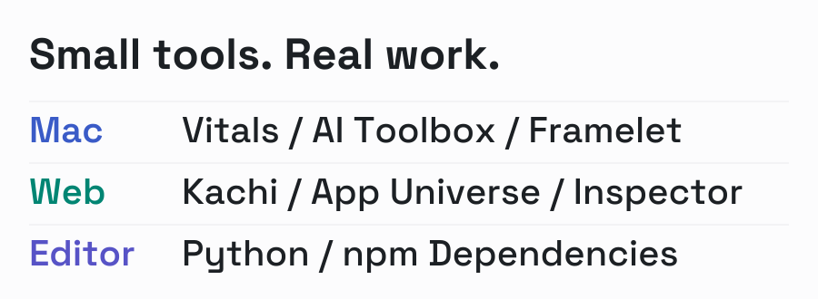

<picture>
  <source media="(prefers-color-scheme: dark)" srcset="assets/workbench-dark.svg">
  
</picture>

# cookabc

I build tools for the work I do every day.

[Mac apps](#mac-apps) &emsp; [Web apps](#web-apps) &emsp; [Editor extensions](#editor-extensions) &emsp; [VeryFun Studio](https://veryfunstudio.github.io/)

### Mac apps

**[Vitals](https://github.com/cookabc/vitals)** 
CPU, GPU, memory, network and battery monitoring in the menu bar.

**[AI Toolbox](https://github.com/cookabc/ai-toolbox)** 
Local usage trends and provider settings for Codex and Claude Code.

**[Framelet](https://github.com/cookabc/Framelet)** 
Record a window or screen area. Preview and export to MP4 or GIF.

Preview the Mac apps

### Web apps

**[Kachi](https://kachi-game.vercel.app)** — learn to distinguish finance-English concepts, with lessons, practice and a knowledge graph. Progress stays on your device. [Source](https://github.com/cookabc/Kachi)

**[App Universe](https://app-universe.vercel.app)** — a curated bilingual collection of design, development and creative tools. [Source](https://github.com/cookabc/app-universe)

**[Agent Inspector](https://github.com/cookabc/zcode-inspector)** — inspect local agent storage, find sessions and preview cleanup. Runs locally with Node.js.

### Editor extensions

**[Python Dependencies Updater](https://marketplace.visualstudio.com/items?itemName=cookabc.python-dependencies-updater)** 
Update hints for `requirements.txt` and `pyproject.toml`, with confirmation before major upgrades.

**[npm Dependencies Updater](https://marketplace.visualstudio.com/items?itemName=cookabc.npm-dependencies-updater)** 
Check and update dependencies in `package.json`.
