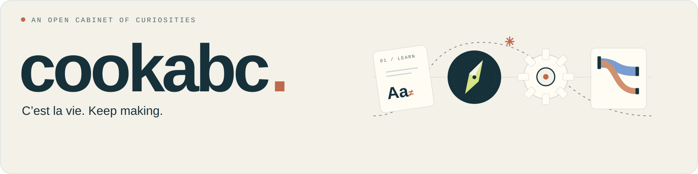
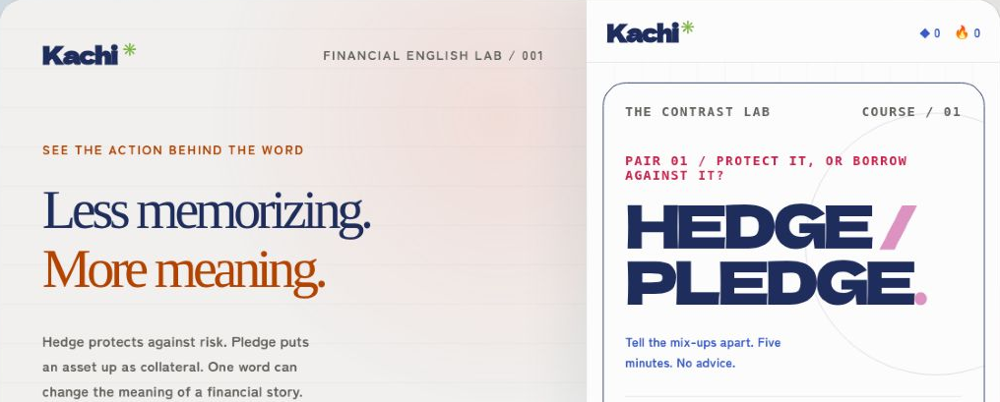
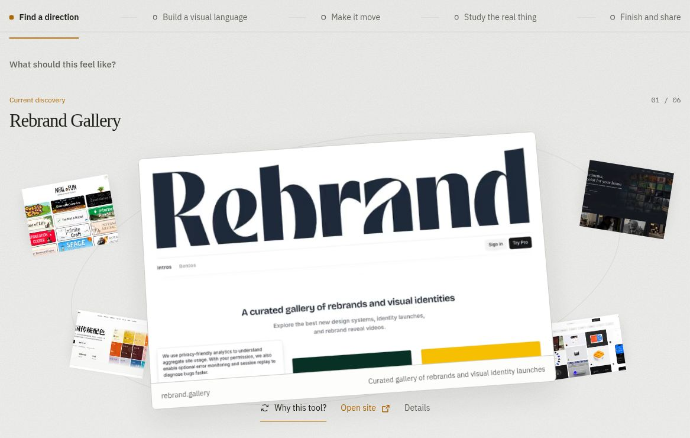
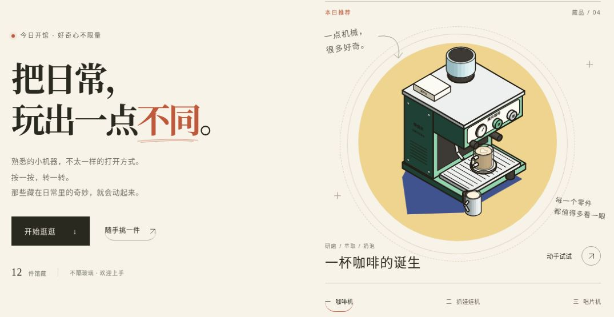
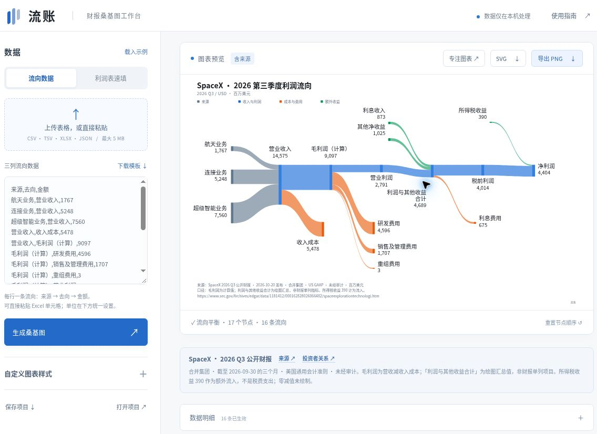

**English** · [简体中文](README.zh-CN.md)

<picture>
  <source media="(max-width: 600px) and (prefers-color-scheme: dark)" srcset="assets/curated-four-20261029/cabinet-mobile-dark.svg">
  <source media="(max-width: 600px)" srcset="assets/curated-four-20261029/cabinet-mobile-light.svg">
  <source media="(prefers-color-scheme: dark)" srcset="assets/curated-four-20261029/cabinet-dark.svg">
  
</picture>

# Useful things, with a playful point of view.

I’m **cookabc**. A few selected public projects for learning, finding, playing and making sense of things.

[Learn](#kachi) · [Discover](#wayseeker) · [Play](#museum) · [Visualize](#flow)

## 01 / Kachi

**Financial English, learned through the distinctions that matter.** Concept pairs, short lessons and practice, in English and Chinese.

[Try it live →](https://kachi-game.vercel.app/) · [View code →](https://github.com/cookabc/Kachi)

<a href="https://kachi-game.vercel.app/">
  <picture>
    <source media="(max-width: 600px)" srcset="assets/curated-four-20261029/kachi-mobile.png">
    
  </picture>
</a>

## 02 / Wayseeker

**Find the next useful tool by starting with the work in front of you.** A bilingual field guide to design and development tools, organised into five working paths.

[Try it live →](https://wayseeker.vercel.app/) · [View code →](https://github.com/cookabc/wayseeker)

<a href="https://wayseeker.vercel.app/">
  <picture>
    <source media="(max-width: 600px)" srcset="assets/curated-four-20261029/wayseeker-mobile.png">
    
  </picture>
</a>

## 03 / Paper Mechanical Museum

**Twelve everyday machines, made into hands-on little exhibits.** Turn, press and explore mechanical ideas on a paper-textured workbench.

[Try it live →](https://paper-mechanical-museum.vercel.app/) · [View code →](https://github.com/cookabc/paper-mechanical-museum)

<a href="https://paper-mechanical-museum.vercel.app/">
  <picture>
    <source media="(max-width: 600px)" srcset="assets/curated-four-20261029/museum-mobile.png">
    
  </picture>
</a>

Includes foundations and derivative work from Colorfigures / ISO-GLOW / iso-figure. [Sources, credits & licensing](https://github.com/cookabc/paper-mechanical-museum/blob/main/THIRD_PARTY_NOTICES.md).

## 04 / Flow Ledger · 流账

**Turn structured financial data into proportional, checkable flows.** A local-first Sankey workspace with data input, balance checks and SVG / PNG export.

[Try it live →](https://financial-sankey-studio.chuangcius.chatgpt.site/) · [View code →](https://github.com/cookabc/financial-sankey)

<a href="https://financial-sankey-studio.chuangcius.chatgpt.site/">
  <picture>
    <source media="(max-width: 600px)" srcset="assets/curated-four-20261029/flow-mobile.png">
    
  </picture>
</a>

The mobile chart scrolls horizontally. Sample amounts in the screenshot illustrate the product, not an independent financial verification.

## A little curiosity break

<strong>Collateral, or protection against risk?</strong>

Putting up an asset as collateral: **PLEDGE**. Managing exposure to risk: **HEDGE**.

Similar-looking words do different work. [Keep exploring in Kachi →](https://kachi-game.vercel.app/)

<strong>More hands-on, less instruction manual?</strong>

[Step up to the hand-cranked generator →](https://paper-mechanical-museum.vercel.app/#/generator). Change the cranking speed and watch the bulb and readouts.

It is an interactive teaching model, not a real-device performance simulation.

About the screenshots & presentation

Captured from the real, live sites on 29 October 2026, with separate desktop and mobile framing. Close-ups are crops, not redrawn interfaces. Kachi shows a concept close-up; Wayseeker shows the workflow and tool preview; the museum shows its coffee machine; Flow Ledger shows its workspace.

Progress and sample data reflect the captured state only. Public source and deployed versions may differ. Project licences and third-party rights remain with their respective repositories.

---

C’est la vie. Stay curious. Keep making.
