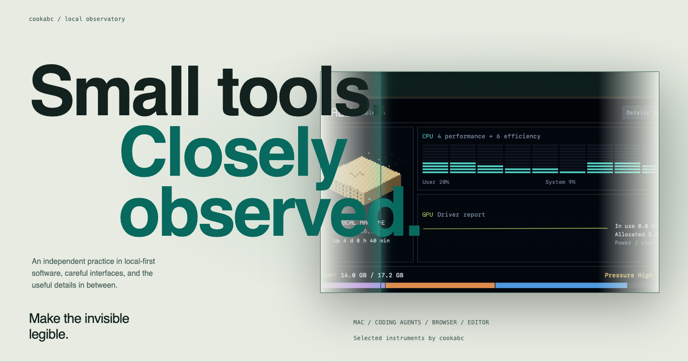
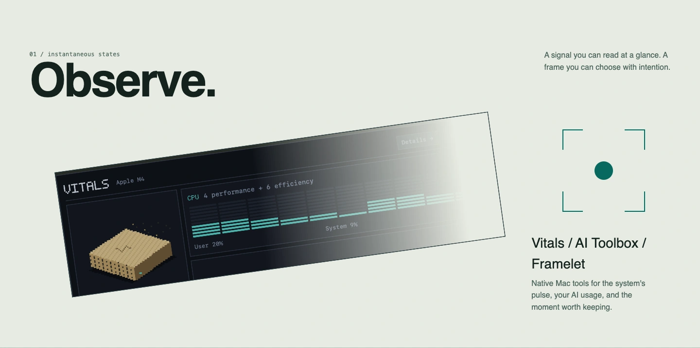
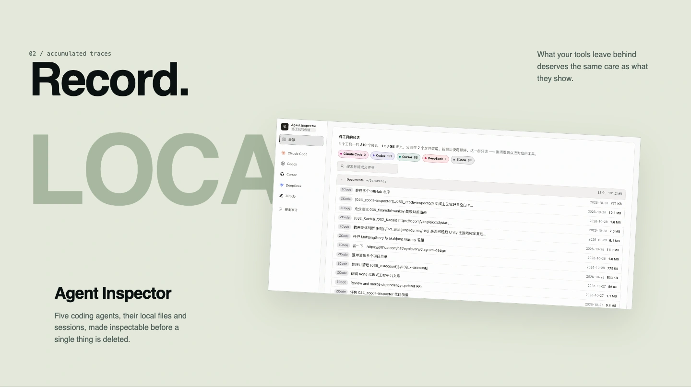

  <a href="https://github.com/cookabc">
    <picture>
      <source media="(max-width: 600px) and (prefers-color-scheme: dark)" srcset="assets/v2/observatory-hero-dark-mobile.svg">
      <source media="(max-width: 600px)" srcset="assets/v2/observatory-hero-light-mobile.svg">
      <source media="(prefers-color-scheme: dark)" srcset="assets/v2/observatory-hero-dark.svg">
      
    </picture>
  </a>

<h2>Observe.</h2>

A signal you can read at a glance. A frame you can choose with intention.

  <picture>
    <source media="(max-width: 600px) and (prefers-color-scheme: dark)" srcset="assets/v2/observatory-observe-dark-mobile.webp">
    <source media="(max-width: 600px)" srcset="assets/v2/observatory-observe-light-mobile.webp">
    <source media="(prefers-color-scheme: dark)" srcset="assets/v2/observatory-observe-dark.webp">
    
  </picture>

**[Vitals](https://github.com/cookabc/vitals)** — a system monitor that lives only in the menu bar, with a live CPU mini-curve and a detailed pixel dashboard. 
**[AI Toolbox](https://github.com/cookabc/ai-toolbox)** — local AI usage, trends and provider switching for Codex and Claude Code. 
**[Framelet](https://github.com/cookabc/Framelet)** — native Mac recording for windows and screen areas, with preview and MP4 or GIF export.

<h2>Record.</h2>

What your tools leave behind deserves the same care as what they show.

  <picture>
    <source media="(max-width: 600px)" srcset="assets/v2/observatory-record-dark-mobile.webp">
    
  </picture>

**[Agent Inspector](https://github.com/cookabc/zcode-inspector)** — local disk usage and session history for five coding agents. Inspect what a cleanup would remove before choosing anything. A separate read-only security audit has no delete action; the page listens on `127.0.0.1` only.

<h2>Understand.</h2>

Less noise. Better distinctions. Experiences that leave room for thought.

  <picture>
    <source media="(max-width: 600px)" srcset="assets/v2/observatory-understand-dark-mobile.webp">
    
  </picture>

**[Kachi](https://kachi-game.vercel.app)** ([source](https://github.com/cookabc/Kachi)) — finance English taught through meaningful distinctions. Local-first, offline-ready, no account. 
**[App Universe](https://app-universe.vercel.app)** ([source](https://github.com/cookabc/app-universe)) — a bilingual, hand-curated field guide to 31 tools, with live previews and notes on when to use them.

### In the editor

- **[Python Dependencies Updater](https://marketplace.visualstudio.com/items?itemName=cookabc.python-dependencies-updater)** — inline update hints for `requirements.txt` and `pyproject.toml`, with confirmation before every major bump.
- **[npm Dependencies Updater](https://marketplace.visualstudio.com/items?itemName=cookabc.npm-dependencies-updater)** — the same treatment for `package.json`.

LOCAL FIRST / THOUGHTFULLY FINISHED

