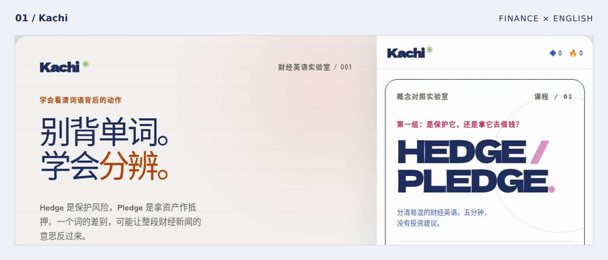
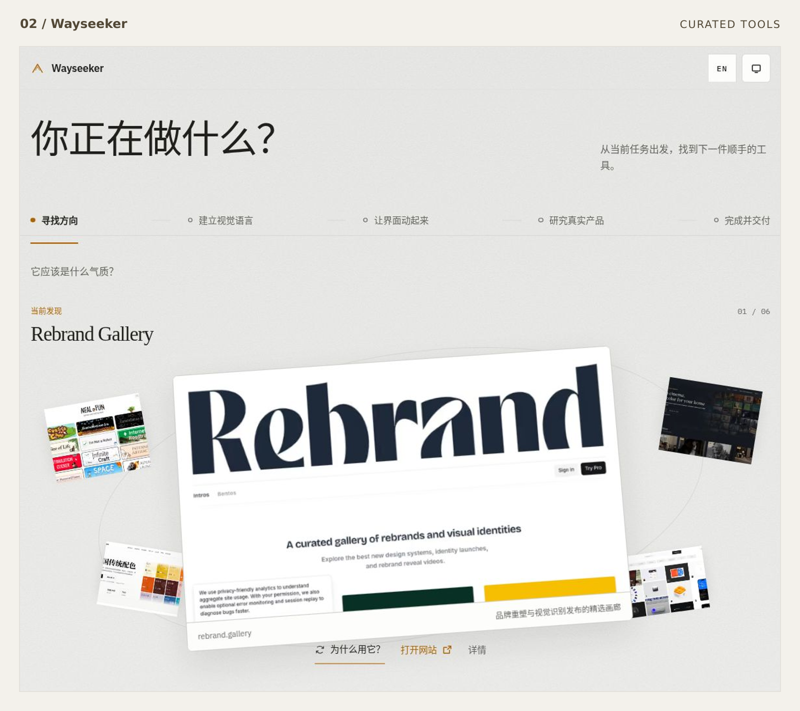

<picture>
  <source media="(max-width: 600px) and (prefers-color-scheme: dark)" srcset="assets/fancy-20261029/studio-mobile-dark.svg">
  <source media="(max-width: 600px)" srcset="assets/fancy-20261029/studio-mobile-light.svg">
  <source media="(prefers-color-scheme: dark)" srcset="assets/fancy-20261029/studio-dark.svg">
  
</picture>

# 把好奇心，做成可以使用的东西。

两个小作品，一条共同的线索：**让理解更清楚，让行动更轻松。**

[01 · 学会分辨](#kachi)　／　[02 · 找到方向](#wayseeker)　／　[打开口袋实验室 ↓](#pocket-lab)

## Selected work

### [Kachi](https://kachi-game.vercel.app/)

**别背单词，学会分辨。** 从 HEDGE / PLEDGE 开始，在概念对照中理解财经英语。

[进入实验室 →](https://kachi-game.vercel.app/) · [查看源码](https://github.com/cookabc/Kachi)

<a href="https://kachi-game.vercel.app/">
  <picture>
    <source media="(max-width: 600px)" srcset="assets/two-projects-20261029/kachi-mobile.png">
    
  </picture>
</a>

### [Wayseeker](https://wayseeker.vercel.app/)

**从当前任务出发，找到顺手的工具。** 人工策展，沿五条工作路径发现工具：从寻找方向，到完成交付。

[寻找下一件工具 →](https://wayseeker.vercel.app/)

<a href="https://wayseeker.vercel.app/">
  <picture>
    <source media="(max-width: 600px)" srcset="assets/two-projects-20261029/wayseeker-mobile.png">
    
  </picture>
</a>

## Pocket lab · 顺手玩一下

<strong>01 / 长得像，意思就一样吗？</strong>

**HEDGE / PLEDGE**

一家公司用资产作抵押来借钱，这里是 HEDGE，还是 PLEDGE？

翻开答案

**PLEDGE.** 关键词是「拿资产作抵押」。HEDGE 关注的是「对冲风险」。

把相似的词放在一起，差异才会浮出来。

[继续在 Kachi 里分辨 →](https://kachi-game.vercel.app/)

<strong>02 / 收藏了很多工具，然后呢？</strong>

先补完这句话：**我现在要完成 ______。**

找方向、做表达、搭产品，还是完成交付？任务明确以后，再去选工具。

[带着这个问题，打开 Wayseeker →](https://wayseeker.vercel.app/)

 

**Stay curious. Make it useful. Repeat.**

---

产品画面实拍于 2026-10-29；数字与学习状态仅代表截图时刻。桌面与窄视口分别取景，局部裁切保留原始内容，未重绘界面。
