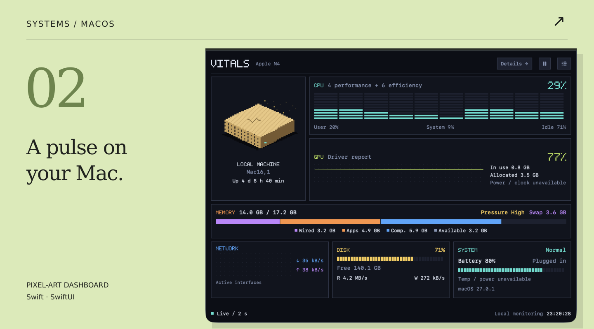
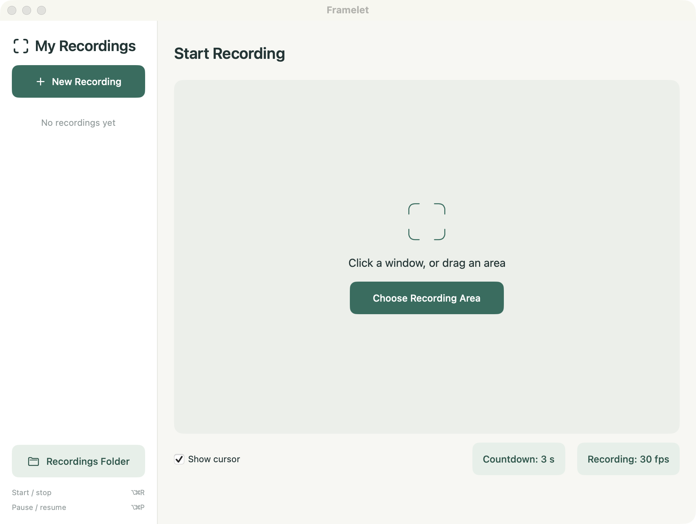

# Selected work

Native macOS apps · Developer tools · Small web experiences

## [Kachi →](https://kachi-game.vercel.app)
金融英语，练成日常。Local-first, offline-capable, no account. **[Open app](https://kachi-game.vercel.app)** · [Source](https://github.com/cookabc/Kachi)

<a href="https://kachi-game.vercel.app">
  <picture>
    <source media="(max-width: 600px)" srcset="assets/redesign-20261029/gallery/kachi-mobile.png">
    
  </picture>
</a>

## [Vitals →](https://github.com/cookabc/vitals)
把 Mac 的脉搏装进菜单栏。CPU, memory, network, disk, battery, and processes. **[Explore source](https://github.com/cookabc/vitals)**

<a href="https://github.com/cookabc/vitals">
  <picture>
    <source media="(max-width: 600px)" srcset="assets/redesign-20261029/gallery/vitals-mobile.png">
    
  </picture>
</a>

## [App Universe →](https://app-universe.vercel.app)
值得留下的工具，认真收集。A hand-curated, bilingual directory for design, gaming, and productivity. **[Explore directory](https://app-universe.vercel.app)** · [Source](https://github.com/cookabc/app-universe)

<a href="https://app-universe.vercel.app">
  <picture>
    <source media="(max-width: 600px)" srcset="assets/redesign-20261029/gallery/universe-mobile.png">
    
  </picture>
</a>

## Also on the workbench

**[Framelet →](https://github.com/cookabc/Framelet)** — 原生窗口与区域录屏。Pause, resume, and export video or GIF.

Framelet starting interface · 查看启动界面

**[zcode-inspector →](https://github.com/cookabc/zcode-inspector)** — 看清编码代理留下的文件。Inspect ZCode, Codex, Claude Code, and Cursor disk usage before choosing what to clean. Zero-dependency Node.js.

**[ai-toolbox →](https://github.com/cookabc/ai-toolbox)** — AI 工具的菜单栏控制台。Local Codex and Claude Code usage stats and provider switching, in a native macOS panel.

**[Python dependencies →](https://github.com/cookabc/python-dependencies-updater) / [npm dependencies →](https://github.com/cookabc/npm-dependencies-updater)** — 在编辑器里更新依赖。VS Code inline update hints, one-click upgrades, and major-version warnings.

---

**[More in the making → All repositories](https://github.com/cookabc?tab=repositories)**

About the images · 作品图来源

展板使用各公开项目仓库提供的真实截图，桌面保留完整截图，手机呈现标明来源的关键局部裁切，并添加编辑式边框与说明；未伪造产品界面。截图中的数字、日期与状态不是实时数据。移动特写仅截取原图区域并等比缩放；Vitals 的两个局部分开陈列，不代表新的产品布局。完整原图见以下链接。

- [Kachi original](https://github.com/cookabc/Kachi/blob/3897e1d8d238b1ebc7a404d324793595b4561956/docs/images/home.png)
- [Vitals original](https://github.com/cookabc/vitals/blob/2e48409967ef7c32d1b97de166f162496223bcc1/docs/images/overview.png)
- [App Universe original](https://github.com/cookabc/app-universe/blob/e2dc018a548d60a4b669677f58b60aee6084e1d6/docs/images/home.png)
- [Framelet original](https://github.com/cookabc/Framelet/blob/5e57859db981e04e7726005e65bcc2c362262768/docs/images/overview.png)

