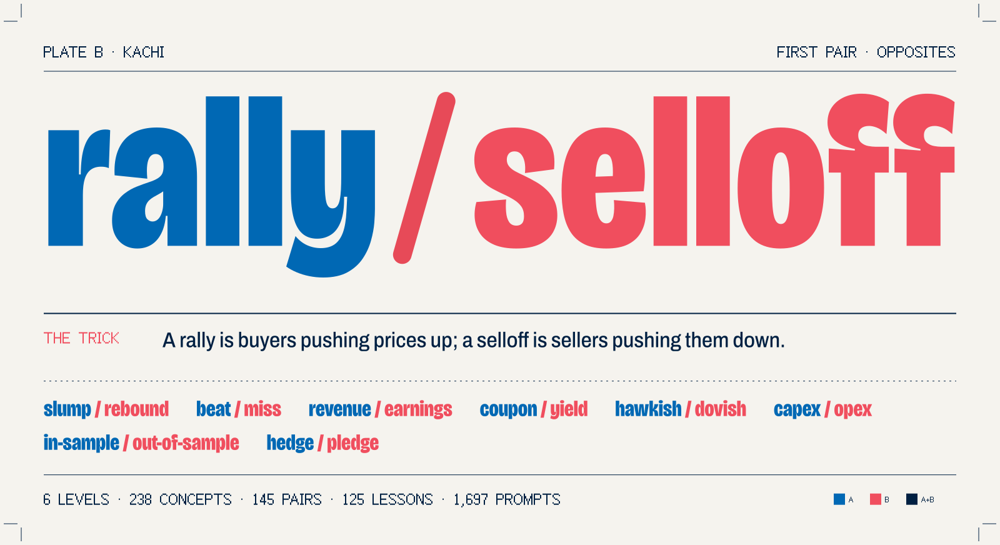
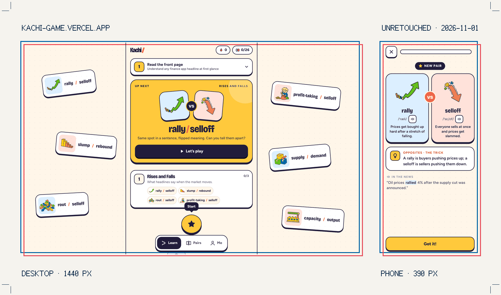
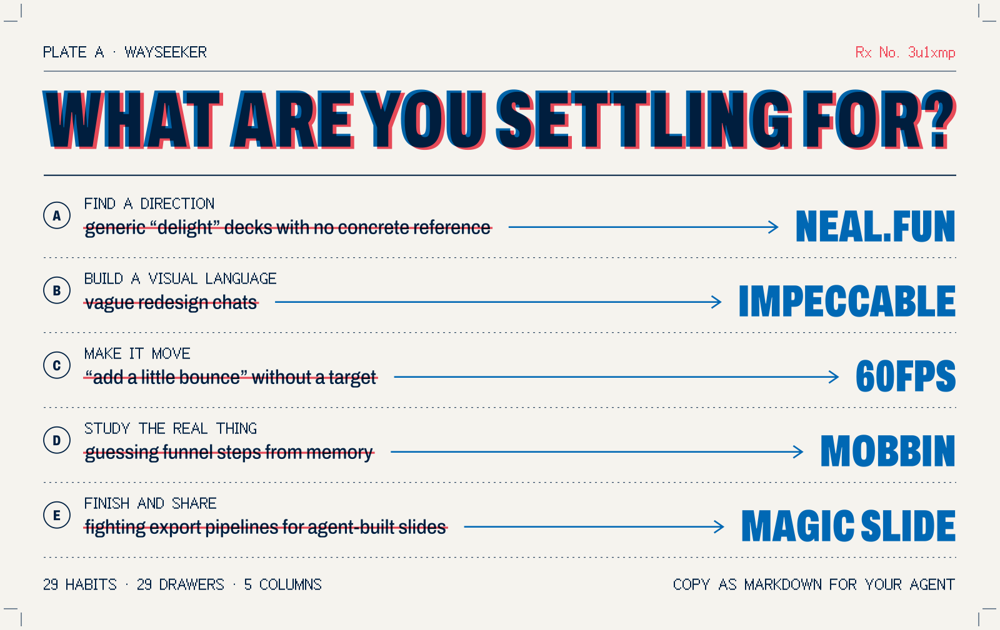
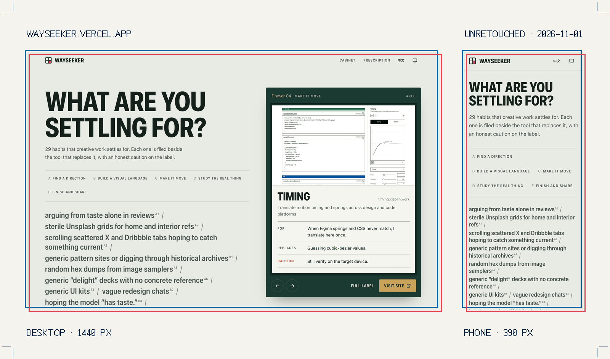

[English](README.md) · **简体中文**

<picture>
  <source media="(max-width: 600px) and (prefers-color-scheme: dark)" srcset="assets/proof-20261101/masthead-mobile-dark.svg">
  <source media="(max-width: 600px)" srcset="assets/proof-20261101/masthead-mobile-light.svg">
  <source media="(prefers-color-scheme: dark)" srcset="assets/proof-20261101/masthead-dark.svg">
  
</picture>

你好，我是 **cookabc**。我做帮人「分清」的小工具：分清一个词和它的双胞胎，分清一个将就的习惯和能替代它的工具。

[Kachi](#kachi) · [Wayseeker](#wayseeker)

## Kachi

**财经英语，成对来学。** 财经标题里错一个词，整条消息的意思就反了。所以每个词都和最容易混淆的「双胞胎」一起出现，每道题都要靠分清两者才能答对。

**[开始玩 Kachi →](https://kachi-game.vercel.app/)** · [源码](https://github.com/cookabc/Kachi)

<a href="https://kachi-game.vercel.app/">
<picture>
  <source media="(max-width: 600px) and (prefers-color-scheme: dark)" srcset="assets/proof-20261101/kachi-proof-mobile-dark.svg">
  <source media="(max-width: 600px)" srcset="assets/proof-20261101/kachi-proof-mobile-light.svg">
  <source media="(prefers-color-scheme: dark)" srcset="assets/proof-20261101/kachi-proof-dark.svg">
  
</picture>
</a>

双胞胎教学卡，配插画、音标和真人录音 · 八种题型，从读财经标题到找回测漏洞 · 不扣血、不判失败，答错的题会在课末再来一次 · 每组词对单独做间隔复习 · 离线可用的 PWA，无需账号，进度只存在本机。

<a href="https://kachi-game.vercel.app/">
<picture>
  <source media="(max-width: 600px) and (prefers-color-scheme: dark)" srcset="assets/proof-20261101/kachi-screens-mobile-dark.png">
  <source media="(max-width: 600px)" srcset="assets/proof-20261101/kachi-screens-mobile-light.png">
  <source media="(prefers-color-scheme: dark)" srcset="assets/proof-20261101/kachi-screens-dark.png">
  
</picture>
</a>

## Wayseeker

**你在将就什么？** 一只装着 29 件设计与代码工具的百子柜。每件工具都放在它所替代的那个将就旁边，标签上写明何时用、替代什么、要注意什么。每个阶段挑一格抽屉，它会为你写一张五行处方，复制成 Markdown 交给你的 Agent。

**[打开百子柜 →](https://wayseeker.vercel.app/)** · [源码](https://github.com/cookabc/wayseeker)

<a href="https://wayseeker.vercel.app/?plan=3u1xmp">
<picture>
  <source media="(max-width: 600px) and (prefers-color-scheme: dark)" srcset="assets/proof-20261101/wayseeker-proof-mobile-dark.svg">
  <source media="(max-width: 600px)" srcset="assets/proof-20261101/wayseeker-proof-mobile-light.svg">
  <source media="(prefers-color-scheme: dark)" srcset="assets/proof-20261101/wayseeker-proof-dark.svg">
  
</picture>
</a>

五列跟着做事的顺序走：找方向 → 建立视觉语言 → 让界面动起来 → 研究真实产品 → 完成并交付。每张标签都写明何时用、替代什么、要注意什么。中英双语。

<a href="https://wayseeker.vercel.app/">
<picture>
  <source media="(max-width: 600px) and (prefers-color-scheme: dark)" srcset="assets/proof-20261101/wayseeker-screens-mobile-dark.png">
  <source media="(max-width: 600px)" srcset="assets/proof-20261101/wayseeker-screens-mobile-light.png">
  <source media="(prefers-color-scheme: dark)" srcset="assets/proof-20261101/wayseeker-screens-dark.png">
  
</picture>
</a>

关于这几张版样

每张版样都只用两种油墨，像一张孔版印刷的打样：蓝色印要留下的，红色印要划掉的。版上的每个词都来自线上产品：Kachi 的 rally / selloff 卡片，和 Wayseeker 的[第 3u1xmp 号处方](https://wayseeker.vercel.app/?plan=3u1xmp)。版样上的英文与产品界面保持一致。截图是 2026-11-01 在 1440 px 和 390 px 宽度下拍摄的线上实拍，没有修图；数字取自各仓库当天的版本。

---

两种油墨，一台印机。保持好奇。
